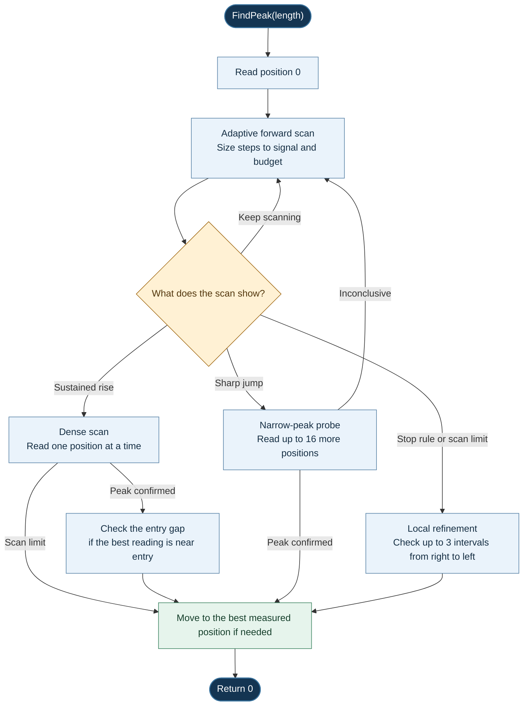

# FocusHunter

FocusHunter is a C++17 autofocus solver that searches for the sharpest lens position under a budget for motor queries, travel, direction reversals, and overshoot. It was developed for the Light Chaser optical track at the [Huawei 2026 France Tech Arena](https://huawei.agorize.com/en/challenges/2026-france-tech-arena).

## The problem

The motor starts at position zero. Each call to `RunMotor(index)` moves the lens to a zero-based position and returns one sharpness reading. `FindPeak(length)` uses those readings to direct the search and leaves the motor parked at its selected position. Noise, narrow peaks, and competing peaks make the stopping decision as important as the search itself.

The challenge score starts at 3,000 points per case. The penalties are 200 points per position of final error, one per query, one per position traveled, 30 per direction reversal, and one per position of overshoot. A case scores zero beyond three positions of final error or at 200 queries, seven reversals, or 200 positions of overshoot.

## Search strategy

The flowchart follows a valid lens range from the first reading to the final motor position. Each `RunMotor` call updates the current position, query count, and best reading seen so far.



| Stage | How the solver decides |
| --- | --- |
| Adaptive scan | Estimate background sharpness and noise from the samples. Widen the steps in low-signal regions and tighten them on a promising rise. In coarse mode, the remaining distance and query budget can force a larger step. |
| Dense scan | Switch to single-position steps when the rise is sustained, prominent above noise, and estimated to be close to its peak. After confirmation, inspect skipped positions immediately before the entry point if the best reading is at or before that point, or only slightly higher a few positions past it. |
| Narrow-peak probe | Test an abrupt jump with up to 16 additional readings. Confirm the peak only when enough neighboring readings support it and the signal falls back toward the background. |
| Coarse stop and refinement | Use peak prominence, width, and the decline after it to decide when to stop advancing. Rank up to three candidate intervals and inspect the previously unread positions in the intervals that fit the remaining budget. |
| Final position | End the forward scan at the last position or after 198 calls if it hasn’t stopped earlier. Reserve one query for parking and cap the full search at 199 calls. Among equal readings, prefer the position closest to the center of the range, then the lower index. |

The search is heuristic. A stronger peak beyond the observed region can be missed when the evidence favors stopping early.

## Run the demo

The standalone demo generates a deterministic sharpness curve and simulates the motor in memory. It requires a C++17 compiler and the standard library.

```sh
g++ -std=c++17 -O2 -Wall -Wextra -Wpedantic -Werror demo.cpp autofocus_cpp/solution.cpp -o focus-hunter
./focus-hunter
```

On Windows with MinGW and PowerShell, use `-o focus-hunter.exe` and run `.\focus-hunter.exe`.

Expected output:

```text
Target index: 172
Final index: 172
Motor queries: 77
Motor travel: 204
Direction reversals: 1
Overshoot: 16
Simulated score: 2673 / 3000
```

## Evaluation

| Evaluation | Version | Result |
| --- | --- | --- |
| Included synthetic demo | Published solver | 2,673 / 3,000, exact peak in 77 queries |
| Organizer’s public sample, run locally | Published solver | 2,832 / 3,000, exact peak in 32 queries |
| Competition judge | Earlier generic version | 1,820.5 average, as recorded during the contest |

The organizer’s sample and the synthetic demo each measure a single curve. The judge score comes from a separate evaluation of the earlier version. The published solver adds a stopping rule for low-prominence peaks that meet stricter shape checks.

## Repository layout

- [`autofocus_cpp/solution.cpp`](autofocus_cpp/solution.cpp) implements `FindPeak` and the search policy.
- [`autofocus_cpp/solution.h`](autofocus_cpp/solution.h) declares the solver entry point.
- [`demo.cpp`](demo.cpp) supplies the simulated `RunMotor` callback and reports the result.
